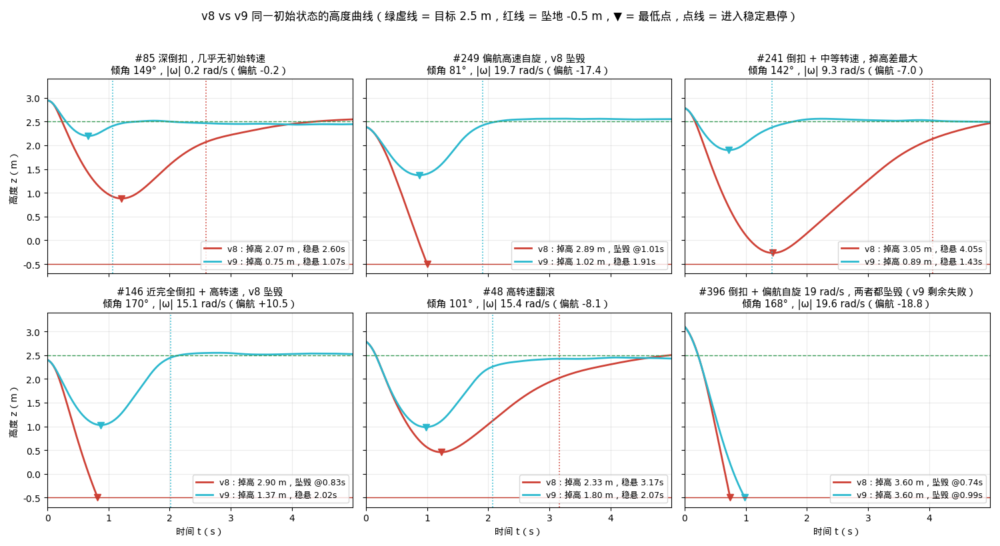

# ESP32-S3 微型四旋翼：任意姿态空中回正与稳定悬停

80g 级微型四旋翼（耀坤 K1.0）在**任意空中姿态**（含完全倒扣、高转速翻滚）下自主回正并稳定悬停 2m 以上，
控制律全部可部署到 ESP32-S3（规则 + 查表，无需联网推理）。

**仿真冠军**：v9 低掉高快速回正控制器（Stage 17）—— 自旋超前补偿 + 约简姿态测地线 bang-bang + 电压感知推力 + 力矩优先分配，
512 通道正式判据下 **99.6%**（8-Seed 均值 99.6%；高转速带 98.6%，深倒扣带 98.8%，坠毁 2/512），
**掉高中位 0.87m（v8 1.17m）、P90 1.57m（v8 2.54m）**，倾斜翻正中位 0.23s，进入稳定悬停中位 1.35s（v8 2.25s）。
传感器噪声与真实姿态估计器复测（Stage 18）：现实噪声下 v9 不受影响；配合**门控 Mahony** 姿态估计器，悲观噪声 + 10s 回合仍为 99.6%。
⚠️ v9 目前**仅仿真验证**（满电开局），尚未移植 C 头文件。

**当前可部署版本**：v8 —— 陀螺力矩前馈 + 临界过阻尼刹车，94.5%，`recovery_expert8.h` 与 Python 按位对齐（误差 1.3e-6），
单步 < 0.65 μs，零堆内存，可直接烧录到 ESP32-S3。

---

## 一句话结论（重要，避免重复走弯路）

这个项目**用系统性实验证伪了"端到端 RL 能解决这个任务"**：
PPO（含课程学习、门控残差、BC 锚定、语义动作层、SIL 自模仿）与 SAC 全路线，在 CPU 可及样本量下
全部收敛于基座控制器天花板，无增长生态位。**唯一有效的成分是"锚定防塌"**。

真正的突破来自**手工控制律 + 物理分析**：
- PD 基座 60.2% → v3 三段式 80.5% → v5 最小时间 bang-bang 84.0% → v6 提前交接 92.4% → v7 级联定点 92.0% → v8 临界过阻尼刹车 94.5% → **v9 自旋超前补偿 99.6%**
- 关键洞察：PD 在倒扣区的油门几何（`tilt_ok=0` 却保留 0.3mg 对称向下推力）是 40% 失败率的真凶，
  不是算法能力问题

---

## 项目结构

```
esp32_fly/
├── code/                    # 嵌入式飞控工程 (ESP-IDF C/C++)
│   └── connection_test/main/recovery_expert{6,7,8}.h  # 各代控制器纯 C 部署头文件
├── RL/
│   ├── env/                 # 动力学引擎与任务环境
│   │   ├── quad_sim_vec.py      # 批量刚体动力学（180k quad-steps/s，对拍误差 1.8e-12）
│   │   ├── vec_recovery_env.py  # 任务环境基类（奖励/观测器/终止/钩子）
│   │   ├── vec_expert9_env.py   # ★ 仿真冠军 v9 低掉高快速回正 (99.6%，尚未移植 C)
│   │   ├── vec_expert8_env.py   # v8 当前可部署版本 (94.5%)
│   │   ├── vec_expert7_env.py   # v7 级联定点自稳 (92.0%)
│   │   ├── vec_expert6_env.py   # v6 提前交接闭环 (92.4%)
│   │   ├── vec_expert5_env.py   # v5 最小时间 bang-bang (84.0%)
│   │   ├── vec_expert_env.py    # v3 三段式 (80.5%)
│   │   ├── vec_residual_env.py  # PD+门控残差（RL 路线）
│   │   ├── vec_rate_env.py      # 语义动作层（RL 路线）
│   │   ├── noise_wrap.py        # 传感器噪声包装（控制器读带噪测量，仿真用真值；Stage 18）
│   │   ├── att_est_wrap.py      # IMU 原始数据 + Mahony 姿态估计器包装（纯陀螺/普通/门控；Stage 18）
│   │   └── yao_kun_params.py    # 耀坤 K1.0 实机参数台账
│   ├── scripts/             # 求解器与训练脚本
│   │   ├── flip_lto.py          # 单轴离线轨迹优化（对拍解析解 0.9%）
│   │   ├── flip_table2.py       # 电机分组建表管线
│   │   ├── flip_lto3d.py        # 三轴严格四元数求解器
│   │   ├── verify_expert8_c_equivalence.py  # C vs Python 逐位等价性验证
│   │   ├── eval_all_controllers.py          # 各代控制器 512 通道横向对比总榜
│   │   ├── eval_recovery_metrics.py         # 掉高量 / 翻正耗时 / 稳悬耗时专项评测（Stage 17）
│   │   ├── sweep_v9.py / final_compare_v9.py / robust_v9.py  # v9 参数扫描、留出种子对比、模型失配测试
│   │   ├── eval_noise.py / eval_noise_att.py / eval_att_est.py  # 噪声分级、姿态误差拆分、真实估计器复测
│   │   ├── visualize_recovery.py            # MuJoCo 3D 交互查看器（配合 run_visualizer.sh）
│   │   ├── visualize_v8_v9.py               # v8 vs v9 同工况并排 3D 对比：交互回放 / 导出视频 / 高度曲线图（Stage 19）
│   │   └── train_*.py           # 各架构训练脚本（保留作对照）
│   ├── models/              # checkpoints 与查表数据
│   └── docs/                # 实验报告与交接文档
├── docs/                    # 硬件文档
└── .devlog/                 # STATE.md 看板 + DEVLOG.md 里程碑
```

---

## 技术指标（实测）

| 项目 | 数值 |
|---|---|
| 机体 | 耀坤 K1.0，全重 80g，轴距 118mm |
| 推力 | 单桨 0.27N @3.7V，TWR@3.7V = **1.38**（边缘设计） |
| 悬停油门 | 0.852 |
| 角加速度上限 | roll 509 / pitch 440 / yaw 73 rad/s²（斜轴仅纯 roll 的 66~71%） |
| 策略推理 | 单次前向 189.4 μs @ ESP32-S3 240MHz（100Hz 闭环下 CPU 1.9%） |
| 仿真吞吐 | 180k quad-steps/s（numpy 批量） |

---

## 成绩单（512 通道严格正式判据）

判据：成功 = **从未坠地 (z > -0.50m)** 且 **连续稳定悬停 ≥50 步**（up_z>0.95, |vz|<0.5, ω<1.2, z>2.0）。

| 策略 | 全局总分 | ω≥14 rad/s | ≥135° 倒扣 | 中位余量 | 备注 |
|---|---|---|---|---|---|
| 纯 PD | 60.2% | 40.0% | 15.2% | +1.02m | 倒扣区对称向下推结构性死穴 |
| model_2M（RL 残差） | 60.5% | 42.7% | 15.2% | +1.03m | 与 PD 无统计差异 |
| v3 三段式 | 80.5% | 72.0% | 54.3% | +1.78m | 基础三段式 |
| v5 最小时间 bang-bang | 84.0% | 73.1% | 60.0% | +1.86m | 切换曲线处理动量 |
| 3D 轨迹查表 (Stage 13) | 52.7% | 43.4% | 1.2% | +1.06m | 单点 95.8%，但连续受低 TWR 开环漂移制约 |
| v6 提前交接闭环专家 | 92.4% | 80.7% | 80.0% | +1.92m | 突破 89% 门槛，但水平漂移大（中位 3.22m） |
| v7 级联定点自稳 | 92.0% | — | — | +1.98m | 中位水平漂移降至 0.054m，漂移>3m 率 55%→1.3%，坠毁 39 架 |
| v8 临界过阻尼刹车 | 94.5% | 85.5% | 84.7% | +2.03m | 当前可部署版本，陀螺前馈 + ζ=1.13 刹车，坠毁 27 架，4-Seed 均值 94.6% |
| **★ v9 低掉高快速回正** | **99.6%** | **98.6%** | **98.8%** | **+2.37m** | **仿真冠军**，自旋超前补偿，坠毁 2 架，8-Seed 均值 99.6%（含 5 个留出种子） |

### 回正掉高与耗时（Stage 17 新增指标，8-Seed 均值，`eval_recovery_metrics.py`）

| 指标 | v8 | v9 | 变化 |
|---|---|---|---|
| 掉高 中位 / P90 / P99 | 1.17 / 2.54 / 3.43 m | **0.87 / 1.57 / 2.57 m** | −26% / −38% / −25% |
| 深倒扣 (≥135°) 掉高 中位 / P90 | 2.04 / 3.06 m | **1.26 / 2.03 m** | −38% / −34% |
| 倾斜翻正耗时 中位 / P90（up_z>0.9 且 \|ω_xy\|<3） | 0.274 / 0.463 s | **0.225 / 0.316 s** | −18% / −32% |
| 进入稳定悬停 中位 / P90 | 2.25 / 3.31 s | **1.35 / 2.08 s** | −40% / −37% |

已知代价：含偏航的完全静止（\|ω\|<3）P90 由 0.99s 变为 1.31s —— 推力余量优先给了升力，偏航自旋停得更慢，不影响稳悬耗时。

模型失配（控制器用名义参数，仿真真值偏离）下 v9 全部优于 v8，最弱项为电机滞后 ×1.4：v9 96.0% vs v8 87.4%。

### 传感器噪声与姿态估计器（Stage 18，5-Seed × 512 均值）

**分级噪声**（`eval_noise.py`，控制器读带噪的姿态/角速度/位置/速度）：

| 噪声等级 | v8 成功率 | v9 成功率 | v9 掉高中位 |
|---|---|---|---|
| 无 / L1 / L2（现实） / L3 | 94.5 / 94.6 / 94.5 / 94.3% | **99.6 / 99.6 / 99.6 / 99.5%** | 0.86~0.88 m |
| L4（悲观：姿态偏置 10°、白噪 4°） | 90.2% | **97.8%** | 0.97 m |
| L5（不现实：姿态偏置 20° > 稳悬判据 18°） | 30.0% | 25.9% | 1.65 m |

单通道隔离（L4 强度）：陀螺噪声、位置速度噪声**均零影响**；退化几乎全部来自**姿态估计误差**。
姿态误差失效点：v9 在固定偏置 ≤10°、白噪 ≤8° 时保持 ≥98.6%。

**真实姿态估计器**（`eval_att_est.py`，1kHz IMU 原始数据：陀螺零偏/白噪/±2000°/s 限幅、加速度计振动噪声 → Mahony）：

| 估计器 | v8 | v9 | 倾角估计误差峰值 中位 / P90 |
|---|---|---|---|
| 理想姿态 | 94.5% | 99.6% | — |
| 纯陀螺积分 | 94.4% | 99.6% | 4.0° / 7.0° |
| 普通 Mahony Kp=2 | 65.1% | 88.6% | 18.3° / 29.6° |
| **门控 Mahony Kp=2** | 93.4% | **99.6%** | **3.5° / 6.2°** |
| 悲观噪声 · 纯陀螺 · 10s | 88.3% | 96.0% | 32.7° / 59.3° |
| **悲观噪声 · 门控 Kp=2 · 10s** | 94.0% | **99.6%** | 10.8° / 20.2° |

结论：**翻转时加速度计不可信**（比力沿机体 z 轴而非指向上方），普通融合会被带偏 18°~30°；
**纯陀螺积分短时准、长时漂**；**门控 Mahony**（比力模长偏离 1g 超 15% 或 |ω| 在 1→3 rad/s 时修正权重降到 0）两头都避开，推荐固件采用，Kp≈2（Kp=5 反而变差）。
全部测试中单轴角速度最大 25.9 rad/s，未触及 MPU6500 ±2000°/s（34.9 rad/s）量程。

### 同工况对比可视化（Stage 19，`visualize_v8_v9.py`）

同一 seed、同一通道 → v8 与 v9 初始姿态 / 角速度 / 高度完全相同，结果与评测逐位一致（`--check` 核对）。



| 通道 | 初始状态 | v8 | v9 |
|---|---|---|---|
| #85 | 倒扣 149°，几乎不转 | 掉高 2.07 m，2.60 s 稳悬 | **掉高 0.75 m，1.07 s 稳悬** |
| #249 | 倾斜 81°，偏航自旋 17 rad/s | **坠毁** @1.01 s | 掉高 1.02 m，1.91 s 稳悬 |
| #241 | 倒扣 142° + 9 rad/s | 掉高 3.05 m（离坠地线仅 0.25 m） | **掉高 0.89 m**，1.43 s 稳悬 |
| #146 | 倒扣 170° + 15 rad/s | **坠毁** @0.83 s | 掉高 1.37 m，2.02 s 稳悬 |
| #48 | 倾斜 101° + 15.4 rad/s | 掉高 2.33 m，3.17 s 稳悬 | 掉高 1.80 m，2.07 s 稳悬 |
| #396 | 倒扣 168°，偏航自旋 19 rad/s | 坠毁 | 坠毁（v9 剩余失败类型） |

交互查看：`./run_visualizer.sh v8v9`（左红 v8 / 右青 v9，`1`~`6` 切换、`B` 随机、空格暂停、`S` 慢放）。
查看器采用"后台进程预计算整段轨迹 + 窗口纯回放"，60~70 fps 流畅播放；随机通道需先计算约 10 s。
对比视频（76 s、0.5× 慢放）：[GitHub Release 下载 v8_vs_v9_6cases.mp4](https://github.com/Frog755/esp32_fly/releases/download/stage19-v8-vs-v9/v8_vs_v9_6cases.mp4)（视频不入库；本地可用 `./run_visualizer.sh export-v8v9` 重新生成到 `RL/results/stage19/`，同时导出曲线图）。

---

## 进行中：真机闭环部署

仿真侧：v8（94.5%）已有按位对齐的 C 头文件；v9（99.6%）已通过噪声与真实姿态估计器复测，待移植 `recovery_expert9.h` + 门控 Mahony 估计器。下一步：

1. 将 `recovery_expert8.h` 接入耀坤主控工程的 FreeRTOS 200Hz 核心姿态控制任务；
2. 链接 MPU6500（**门控 Mahony** 四元数估计，Kp≈2）与 BMP280（气压计互补滤波）真实传感器；
3. 交叉编译固件，开发板刷写并执行台架姿态回正自检。

详见 [.devlog/STATE.md](.devlog/STATE.md)。

## 已归档：翻转查表控制器（Stage 13）

思路：把 v5 的翻转段换成**离线最优轨迹**，部署到 ESP32 查表执行。

```
任意倒扣 ─→【翻转段：查表】─→ 交接姿态 ─→【v5 规则收尾】─→ 稳定悬停
```

**已验证**：单轴求解器对拍解析解 0.9%；单轴"表+规则收尾"闭环实跑 286 步稳定悬停。
**已判负**：单轴简化模型建表（42 格真实仿真只过 7 格，模型乐观 2.4m）。
**结论**：3D 轨迹查表单点 95.8%，但连续受低 TWR 开环漂移制约，512 通道仅 52.7%，已被 v6~v8 闭环规则控制器取代；
查表数据（`RL/models/flip_table_3d.npz`、`flip_table.h`）保留归档，交接文档见
[RL/docs/交接说明-Stage13查表控制器.md](RL/docs/交接说明-Stage13查表控制器.md)。

---

## 文档索引

**看板与历程**
- [.devlog/STATE.md](.devlog/STATE.md) —— 当前状态与下一步 —— **新对话必读**
- [.devlog/DEVLOG.md](.devlog/DEVLOG.md) —— 里程碑档案（v7 见 Stage 14，v8 见 Stage 16）
- [RL/docs/交接说明-Stage13查表控制器.md](RL/docs/交接说明-Stage13查表控制器.md) —— Stage 13 查表方案交接（已归档）

**实验报告**
- [RL/docs/实验总览.md](RL/docs/实验总览.md) —— 全部实验总表
- [RL/docs/奖励函数迭代实验日志.md](RL/docs/奖励函数迭代实验日志.md) —— 逐轮过程
- [RL/docs/PlanA完整历程与第一轮训练报告.md](RL/docs/PlanA完整历程与第一轮训练报告.md) —— RL 路线的完整尸检

---

## 关键教训（5 次判据事故）

1. `up_z_of` 轴写错（R00 当 R22）→ 姿态判据对 x 轴翻滚失明
2. 静态表 auto-reset 污染 → 把"重置后的运气态"当成技能
3. 训练脚本手工 reset → 单通道坠地重启全部通道，成绩被系统压低
4. 单轴/三轴电机组映射对调 → 动力学残差 5.99
5. 单轴模型乐观 2.4m → 表必须每格全仿真验证

**铁律**：任何两套实现，必须用固定状态逐项对拍导数；任何判据，必须先验证它测的是你以为的东西。

---

## 快速开始

```bash
./run_visualizer.sh v8v9              # MuJoCo 3D：v8 vs v9 同工况并排对比（推荐）
./run_visualizer.sh                   # MuJoCo 3D 对决：v6 vs v8（另有 v8 / v7 / v6 单机视口）
cd RL
python3 scripts/eval_all_controllers.py          # 各代控制器 512 通道横向对比总榜
python3 scripts/eval_recovery_metrics.py --ctrl vec_expert9_env:VecExpert9 vec_expert8_env:VecExpert8  # 掉高/耗时专项
python3 scripts/verify_expert8_c_equivalence.py  # v8 C 头文件 vs Python 逐位等价校验
python3 scripts/flip_lto.py           # 单轴求解器三道 sanity 检查
python3 scripts/flip_table2.py        # 电机分组参数化建表测试
python3 -c "import scipy; print(scipy.__version__)"   # 需 1.15+
```

依赖：numpy 2.x / scipy 1.15+ / stable-baselines3 2.9.2 / torch (CPU) / gymnasium

---

## 许可证

本项目以 [MIT License](LICENSE) 发布。第三方代码（RLtools / RAPTOR，MIT）的版权声明见
[THIRD_PARTY_NOTICES.md](THIRD_PARTY_NOTICES.md)。
